# Multimodal Deception Detector Architecture

Comprehensive architecture specification and data flow diagram for `src/models` and `src/evaluation`.

```mermaid
flowchart TD
    %% ==========================================
    %% SUBGRAPH: INPUT DATA
    %% ==========================================
    subgraph DataInput["Input: MultimodalBatch"]
        V_in["visual_feats: (B, T, D_vis)<br/>visual_mask: (B, T)"]
        A_in["audio_feats: (B, T, D_aud)<br/>audio_mask: (B, T)"]
        T_in["text_feats: (B, L, D_txt)<br/>text_mask: (B, L)"]
        Align_in["alignment_indices: (B, L, 2)<br/>Maps word l to [start, end] frame"]
        Label_in["label: (B,) Ground Truth"]
        Meta_in["subject_id: List[str]<br/>clip_id: Optional[List[str]]"]
    end

    %% ==========================================
    %% SUBGRAPH: BLOCKS 2 & 3 ENCODERS & POOLING
    %% ==========================================
    subgraph Block2_3["Blocks 2 & 3: TemporalEncoderBank & Masked3DPooling"]
        direction TB
        V_Enc["TemporalConvEncoder (Visual)<br/>Conv1d (d=1, k=3) -> Conv1d (d=2, k=3) + LN<br/>-> H_v: (B, T, D)"]
        A_Enc["TemporalConvEncoder (Audio)<br/>Conv1d (d=1, k=3) -> Conv1d (d=2, k=3) + LN<br/>-> H_a: (B, T, D)"]
        T_Enc["TextEncoder (Linguistic)<br/>Linear(D_txt, D) + GELU + LN<br/>-> H_t: (B, L, D)"]

        Pool_V["Masked3DPooling (Visual)<br/>[Mean; Std; Max] -> Linear(3D -> D) + LN<br/>-> P_v_raw: (B, D)"]
        Pool_A["Masked3DPooling (Audio)<br/>[Mean; Std; Max] -> Linear(3D -> D) + LN<br/>-> P_a_raw: (B, D)"]
        Pool_T["Masked3DPooling (Text)<br/>[Mean; Std; Max] -> Linear(3D -> D) + LN<br/>-> P_t_raw: (B, D)"]

        V_in --> V_Enc --> Pool_V
        A_in --> A_Enc --> Pool_A
        T_in --> T_Enc --> Pool_T
    end

    %% ==========================================
    %% SUBGRAPH: BLOCK 4 MODALITY DROPOUT & GATE
    %% ==========================================
    subgraph Block4["Block 4: ModalityDropoutAndGate"]
        NatMask["natural_mask = stack([any(v), any(a), any(t)])<br/>Shape: (B, 3)"]
        ActMask["active_mask Sampling<br/>Bernoulli(1 - p_drop) + >=1 Modality Rescue<br/>Shape: (B, 3)"]
        GateScorer["Gate Scoring & Softmax<br/>Linear(D -> 1) per modality<br/>weights = softmax(masked_logits)<br/>Shape: (B, 3)"]
        GlobalPath["Global Modality Path (P)<br/>P = sum(weights_m * P_m_raw)<br/>Shape: (B, D)"]

        NatMask --> ActMask --> GateScorer --> GlobalPath
    end

    Pool_V --> NatMask
    Pool_A --> NatMask
    Pool_T --> NatMask
    Pool_V --> GlobalPath
    Pool_A --> GlobalPath
    Pool_T --> GlobalPath

    %% ==========================================
    %% SUBGRAPH: BLOCK 5 SPAN INTERACTION
    %% ==========================================
    subgraph Block5["Block 5: SpanInteraction"]
        SpanMaskGen["Span Mask Construction<br/>[start - k, end + k] bounded in [0, T-1]<br/>AND effective_text_mask AND frame_mask<br/>-> span_mask_v, span_mask_a: (B, L, T)"]
        SpanPool["Word-Span Feature Pooling<br/>span_avg OR span_qkv (MHA with Q=H_t, KV=H_m)<br/>-> V_word, A_word: (B, L, D)"]
        SpanConcat["Concatenate Word Representation<br/>[H_t; V_word; A_word; len_v; len_a; valid_flag]<br/>Shape: (B, L, 3D + 3)"]
        SpanProj["Word Projection & Attentive Pool<br/>Linear(3D+3 -> D) + GELU + LN -> S_words<br/>Attentive Softmax Scorer -> S_pooled: (B, D)"]
        SpanOut["Zero-Init Output Projection<br/>Linear(D -> D) * text_active<br/>-> S: (B, D)"]

        SpanMaskGen --> SpanPool --> SpanConcat --> SpanProj --> SpanOut
    end

    V_Enc -->|"H_v"| SpanPool
    A_Enc -->|"H_a"| SpanPool
    T_Enc -->|"H_t"| SpanConcat
    Align_in --> SpanMaskGen
    ActMask -->|"active_mask"| SpanPool
    ActMask -->|"active_mask"| SpanOut

    %% ==========================================
    %% SUBGRAPH: BLOCKS 6, 7 & 8 FUSION & HEADS
    %% ==========================================
    subgraph Block6_7_8["Blocks 6, 7 & 8: Residual Fusion & Classifiers"]
        ResGate["Block 6: Residual Fusion Gate<br/>g = sigmoid(W_g [P; S] + b_g) in (B, D)<br/>Z = P + g * S in (B, D)"]
        MainHead["Block 7: Main Deception Classifier<br/>LN -> Linear(D -> D/2) -> GELU -> Dropout -> Linear(D/2 -> 1)<br/>-> logits: (B,)"]
        AuxHeads["Block 8: Auxiliary Unimodal Heads<br/>aux_head_v(P_v_raw) -> aux_logits['visual']: (B,)<br/>aux_head_a(P_a_raw) -> aux_logits['audio']: (B,)<br/>aux_head_t(P_t_raw) -> aux_logits['text']: (B,)"]

        GlobalPath -->|"P"| ResGate
        SpanOut -->|"S"| ResGate
        ResGate -->|"Z"| MainHead
        Pool_V -->|"P_v_raw"| AuxHeads
        Pool_A -->|"P_a_raw"| AuxHeads
        Pool_T -->|"P_t_raw"| AuxHeads
    end

    %% ==========================================
    %% SUBGRAPH: BLOCK 10 CONFLICT HEAD
    %% ==========================================
    subgraph Block10["Block 10: ConflictHead (AV Synchrony)"]
        DetachGate["Detach Gate (optional)<br/>detach_inputs: H_v.detach(), H_a.detach()"]
        ProjVA["Projection Heads<br/>proj_v(H_v) -> v, proj_a(H_a) -> a<br/>L2 Normalized: (B, T, d_share)"]
        ConflictTrace["Frame-Level Conflict Trace<br/>c_trace = (1 - v * a) * frame_valid<br/>Shape: (B, T) in [0, 2]"]
        WordConflict["Word-Level Conflict Mapping<br/>Vectorized mean over word intervals [start, end]<br/>-> word_conflict: (B, L)"]
        AlignLoss["Temporal InfoNCE Loss (Training only)<br/>Positive: same frame t<br/>Negatives: temporal far |t-s|>=30 & cross-clip at t<br/>-> align_loss: scalar"]
        SyncGapCheck["sync_gap Validation Metric<br/>Delta_c = mean(c_shift) - mean(c_true)<br/>(Expect > 0 on valid audio shift)"]

        DetachGate --> ProjVA --> ConflictTrace --> WordConflict
        ProjVA --> AlignLoss
        ProjVA --> SyncGapCheck
    end

    V_Enc -->|"H_v"| DetachGate
    A_Enc -->|"H_a"| DetachGate
    NatMask -->|"natural_mask"| ConflictTrace
    Align_in -->|"alignment_indices"| WordConflict

    %% ==========================================
    %% SUBGRAPH: EVALUATION - LOSSES
    %% ==========================================
    subgraph EvalLoss["src/evaluation/losses.py: MultimodalDeceptionLoss"]
        direction TB
        LossSmooth["Binary Label Smoothing<br/>y_smooth = y*(1 - eps) + 0.5*eps"]
        MainLoss["Main BCE Loss<br/>BCEWithLogits(logits, y_smooth)"]
        AuxLoss["Unimodal Aux Loss (Natural Mask Filtered)<br/>sum_m( (BCE(aux_m, y) * natural_mask_m) / count_m )"]
        ConfLoss["Conflict Loss<br/>lambda_conflict * align_loss"]
        TotalLoss["Total Objective<br/>total_loss = L_main + lambda_aux * L_aux + lambda_conflict * L_conflict"]

        LossSmooth --> MainLoss --> TotalLoss
        AuxLoss --> TotalLoss
        ConfLoss --> TotalLoss
    end

    MainHead -->|"logits"| MainLoss
    AuxHeads -->|"aux_logits"| AuxLoss
    NatMask -->|"natural_mask"| AuxLoss
    AlignLoss -->|"align_loss"| ConfLoss
    Label_in -->|"label"| LossSmooth

    %% ==========================================
    %% SUBGRAPH: EVALUATION - METRICS
    %% ==========================================
    subgraph EvalMetrics["src/evaluation/metrics.py: DeceptionEvaluator"]
        direction TB
        Accumulator["Update Accumulator<br/>Aggregates window-level logits, labels, subject_ids, clip_ids"]
        ClipAgg["Window-to-Clip Aggregation<br/>prob_mean: mean(sigmoid(logits))<br/>logit_mean: sigmoid(mean(logits))"]
        ThreshOpt["Threshold Calibration (Validation split only)<br/>Tuned via Macro-F1, Youden's J, or Max TPR @ FPR <= 10%"]
        PointMetrics["Point Metrics<br/>AUC-ROC, Macro-F1, FPR, TPR, ECE (10 bins)"]
        SubjectBootstrap["Subject-Level Non-Parametric Bootstrap<br/>Resamples subjects with replacement (1000 replicates)<br/>-> 95% Confidence Intervals (AUC, F1, FPR, TPR, ECE)"]

        Accumulator --> ClipAgg --> ThreshOpt --> PointMetrics --> SubjectBootstrap
    end

    MainHead -.->|"logits (inference)"| Accumulator
    Label_in -.->|"labels"| Accumulator
    Meta_in -.->|"subject_ids, clip_ids"| Accumulator
```

---

## Architecture Flow & Component Summary

| Block | Component | Input | Output | Purpose & Role |
| :--- | :--- | :--- | :--- | :--- |
| **Blocks 2 & 3** | `TemporalEncoderBank` & `Masked3DPooling` | `(B, T, D_vis)`, `(B, T, D_aud)`, `(B, L, D_txt)` | `H_m: (B, T/L, D)`, `P_m_raw: (B, D)` | Extracts continuous temporal representations via dilated 1D Convs and text projections, then creates NaN-safe pooled vectors `[Mean; Std; Max]` |
| **Block 4** | `ModalityDropoutAndGate` | `P_m_raw`, modality frame masks | `P: (B, D)`, `active_mask: (B, 3)`, `weights: (B, 3)` | Simulates missing modalities during training with guaranteed $\ge 1$ active modality, dynamically computing softmax or uniform weights |
| **Block 5** | `SpanInteraction` | `H_v`, `H_a`, `H_t`, `alignment_indices` | `S: (B, D)` | Aligns facial AUs and acoustic pitch/energy to transcript word boundaries $[start - k, end + k]$, pools cross-modal features, and applies attentive sequence pooling |
| **Block 6** | Residual Fusion Gate | $P \in \mathbb{R}^{B \times D}$, $S \in \mathbb{R}^{B \times D}$ | $Z \in \mathbb{R}^{B \times D}$ | Learns adaptive dynamic gate $g = \sigma(W_g [P; S] + b_g)$ and fuses representations: $Z = P + g \odot S$ (zero-initialized at step 0 so $Z = P$) |
| **Block 7** | Main Classifier Head | $Z \in \mathbb{R}^{B \times D}$ | $\hat{y} \in \mathbb{R}^B$ (logits) | LayerNorm $\to$ Linear bottleneck ($D \to D/2$) $\to$ GELU $\to$ Dropout $\to$ Linear($D/2 \to 1$) |
| **Block 8** | Auxiliary Unimodal Heads | $P_{v,\text{raw}}, P_{a,\text{raw}}, P_{t,\text{raw}}$ | $\hat{y}_v, \hat{y}_a, \hat{y}_t \in \mathbb{R}^B$ | Regularizes unimodal encoders using undropped features to prevent dominant modality collapse |
| **Block 10** | `ConflictHead` | $H_v, H_a$, `alignment_indices` | `c_trace: (B, T)`, `word_conflict: (B, L)`, `align_loss` | Level-1 physical incongruence estimator trained self-supervised via temporal InfoNCE with temporal and cross-clip negative sampling |
| **Evaluation** | `MultimodalDeceptionLoss` | `FusionNetOutput`, `label` | `total_loss` (grad), detached logging breakdown | Multi-task objective combining label-smoothed BCE, naturally-masked auxiliary BCEs, and temporal InfoNCE synchrony loss |
| **Evaluation** | `DeceptionEvaluator` | Accumulated logits, labels, subject IDs, clip IDs | `EvaluationReport` (AUC, F1, FPR, TPR, ECE, CIs) | Strict zero-leakage evaluation: clip aggregation, validation-only threshold tuning, and subject-level bootstrap confidence intervals |
